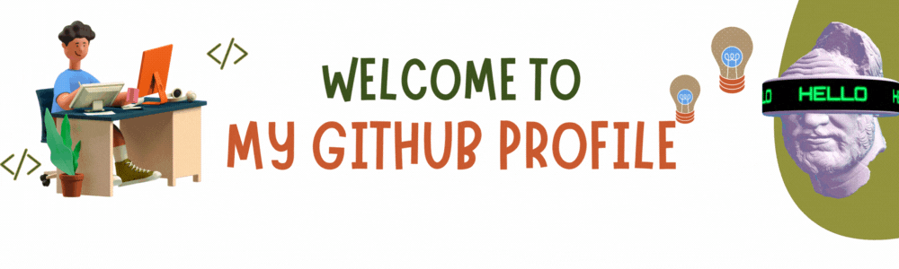

# Hello there 👋


[](https://github.com/0xYujan/Solidity/)

<div align="center">
  
</div>
<br>
<br>

<p align="center">
</p>

```python
#!/usr/bin/python
# -*- coding: utf-8 -*-


class BlockchainDeveloper:

    def __init__(self):
        self.name = "Yujan Ranjitkar"
        self.role = "Blockchain Developer"
        self.language_spoken = ["ne_NP", "en_US"]
        
    def say_hi(self):
        print("Thanks for dropping by, hope you find some of my work interesting.")
        
me = BlockchainDeveloper()
me.say_hi()
```

## 📝 Blogs

- Personal Website: https://yujanranjitkar.com.np

## Company 
- TBT Main Website: https://techboxtec.com
- TBT Hosting: https://hosting.techboxtec.com

<br>

## 🔧 Technologies & Tools


<br>

## ⌨️ Language

<br>

## ☠️ Hacktoberfest 2022
[](https://holopin.io/@yujan1)
<br>


<br />
<!-- ## 👨‍💻 This week, I spent my time on:
[](https://github.com/anuraghazra/github-readme-stats) -->
